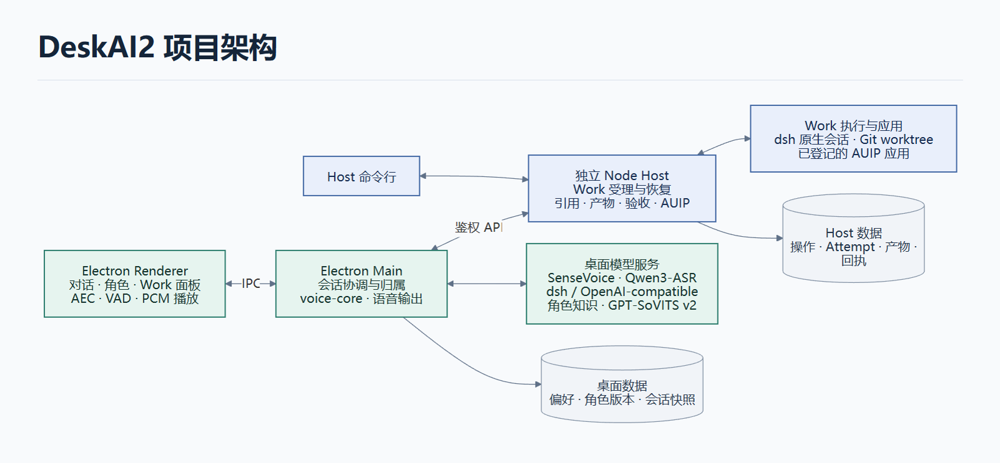

# DeskAI2 架构

[架构图源文件](./architecture.mmd)

## 进程与职责

- **Electron Renderer** 显示对话、角色编辑和 Work 面板。麦克风、输出参考、AEC、Silero VAD、插话确认及 PCM 播放在本地 AudioWorklet 和音频图中运行。Preload 暴露有限 IPC，主进程检查调用窗口与来源。[桌面入口](../../apps/desktop/src/main.ts) · [Preload](../../apps/desktop/src/preload.cts) · [采集](../../apps/desktop/renderer/public/worklets/voice-capture.js) · [播放器](../../apps/desktop/renderer/src/player.ts)
- **Electron Main** 装配会话和服务。TurnCoordinator 绑定采集会话与归档会话，管理规划生命周期、引用选择和取消。CharacterStore 保存角色版本，ConversationArchive 固定每个会话的角色快照和关系。SpeechOutput 按句调度合成、控制前视量，并把播放回执交给对话控制器。[会话协调](../../apps/desktop/src/turn-coordinator.ts) · [角色与会话存储](../../apps/desktop/src/character-store.ts) · [语音输出](../../apps/desktop/src/speech-output.ts)
- **语音核心与适配器** 将分段、端点、投机确认、文本投影、交付状态与模型调用分开。dsh 和 OpenAI-compatible 实现同一 Chat 端口。桌面拥有 SenseVoice/规划用的 dsh 进程、Qwen 子进程、知识检索子进程和 TTS 子进程。Qwen 与知识检索使用私有标准流，TTS 使用本机鉴权 WebSocket。[对话核心](../../packages/voice-core/src/dialogue.ts) · [Chat 端口](../../packages/voice-core/src/chat-contract.ts) · [识别路由](../../apps/desktop/src/speech-runtime.ts) · [TTS 适配器](../../packages/tts-adapter/src/index.ts)
- **独立 Node Host** 提供本机鉴权 API、状态订阅和命令行入口。Host 持有 Work 账本、dsh 执行运行时、工作区、产物和 AUIP 会话。关闭桌面时 Work 可继续运行，桌面和 CLI 重新连接读取同一状态目录。[Host 入口](../../apps/host/src/server.ts) · [本机 API](../../apps/host/src/api.ts) · [Work 账本](../../packages/work-core/src/host.ts) · [AUIP](../../packages/app-core/src/app-host.ts)

## 从输入到交付

1. 语音帧先按当前采集会话和输出代次进入分段。待机使用 SenseVoice 识别唤醒词，连续会话默认使用 Qwen3-ASR。短静音允许候选转写及候选回复，续说和插话让旧候选失效。
2. 正式输入使用当前归档会话。规划器读取 Host 本轮冻结的候选和能力。普通对话走 Chat。涉及任务或应用时，Host 校验候选、消歧并返回实际回执。切换角色或会话会撤销尚未受理的规划，已受理 Work 仍按操作 ID 可查。[对话引用](../../apps/host/src/conversation-control.ts)
3. Chat 使用角色快照、关系和已交付历史。启用知识检索时，按角色 ID 查询对应索引，将命中的片段和定位送入本轮。候选回复只在正式文本、角色和 Host 上下文匹配后放行。语音回复由 TTS v2 合成并回传 PCM，文字回复由界面确认显示。[对话投影](../../packages/voice-core/src/chat-context.ts) · [投机回复](../../packages/voice-core/src/speculative-chat.ts) · [知识检索](../../apps/desktop/src/character-knowledge.ts)
4. 输出以会话、代次、Attempt、句子和音色修订校验身份。打断时清掉旧 PCM，等待已取消的合成退出。语音历史只收录完整播放的句子，文字历史收录界面确认过的正文。[交付账本](../../packages/voice-core/src/delivery.ts)

## Work 的持久化与验收

1. 操作先进入 WorkHost 的受理入口。操作 ID 和指纹绑定 Work 与 Attempt，并在 Provider 调用前持久化。相同 ID 和请求取回原回执，请求内容冲突时拒绝。dsh 使用同一操作 ID 绑定原生提示请求。[操作协议](../../packages/work-core/src/operations.ts)
2. Git 项目从已提交 HEAD 创建任务分支与 worktree。继续和重试沿用任务工作区。非 Git 或无提交项目在 Host 内用目录写入锁。Attempt 保存执行前后快照，断线时通过原生快照和日志恢复。[工作区](../../packages/work-core/src/workspace.ts) · [dsh 恢复](../../packages/dsh-adapter/src/work-provider.ts)
3. Host 结合终态、预期文件、变更归属、当前摘要和待处理输入评估交付。用户确认前重新核验，保存验收回执。产物登记、预览和导出均绑定 Attempt。应用通过登记的 manifest 进入 AUIP 会话，状态修订、动作回执、协作租约和断线由 Host 核对。[交付核验](../../apps/host/src/work-delivery.ts) · [完成评估](../../packages/work-core/src/completion.ts) · [导出](../../packages/app-core/src/exports.ts)

## 配置和所有权

`config/` 是源码配置入口。输入、Chat、TTS、Work 和角色语料分别有独立清单。桌面目录保存界面设置、角色与会话。Host 目录保存执行和交付。模型资源与派生索引由各自进程加载。运行、配置覆盖与数据位置见[运行说明](./operations.md)。
