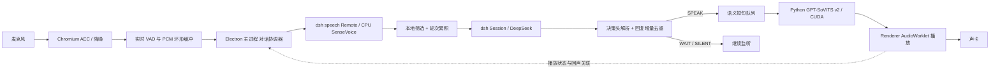

# 架构与接口契约

2026-10-30 当前实现：M3 的认证 TTS adapter、有限句队列、带身份 PCM/播放回执和十声音切换已经接入；M4 增加托盘、单实例、独立设备/偏好、预热与目录包。打开窗口只预热，点击开始才采音。实际接口修订（模型选择复用、WAIT/SILENT 的 EOF 末行）见 [查证记录](./m3-m4-interface-notes.md)，实现与验证见 [M3–M4 报告](./m3-m4-validation.md)。以下“建议”段保留设计出发点，当前代码以上述实现契约为准。

## 进程分工

- Renderer：本地静态 UI、getUserMedia、AEC 请求、AudioWorklet、采样转换、实时 VAD。开启 contextIsolation/sandbox，关闭 nodeIntegration，仅暴露窄 IPC；不持有模型凭据、不接收任意执行命令。
- Electron main：进程管理、dsh 认证连接、输入累积、会话状态、回应协议解析、TTS 队列、配置和诊断。耗时 DSP 不放在主事件循环。
- dsh Host：受控 Web profile，保留账户/模型/Session/Voice Input。安装一个仅对话 preset，不把开发环境的终端/文件/MCP 工具带入语音聊天。人格可以由无工具的提示词插件提供；最终工具表必须实测为空。
- TTS worker：现有 `.conda/gsv-v5/python.exe` + 已修改的 GPT-SoVITS 本地代码，单 GPU、单模型执行线程；独立控制线程可接受 cancel，不能在长合成阻塞期间停止读控制命令。

不改现有 `npm start` 的 dsh 用途；新入口建议 `npm run desktop:dev`、独立 `启动桌面语音对话.cmd`。训练与试听目录保持原状。

注意现有 `scripts/gsv_v5/common.py` 的 activate 会写入 v5 训练环境变量；应用不能无条件继承这些角色/版本配置。可以复用环境和DLL路径知识，但v2 worker必须在导入推理模块前显式设置版本、预训练资源和自己的配置输出位置，避免写回训练目录。

## dsh 适配

2026-10-28 接口核对：已安装语音包不等于默认 Web profile 启用了 speech Remote；未挂载时 `speech/catalog` 实测为 HTTP 404。桌面专用启动 patch 必须显式加入官方 voice-input bundle 的 speech-to-text、SenseVoice、api-speech-to-text 与客户端 Remote 注册条目，不能据 npm 包存在就显示 ASR 已准备。另全局 `tool-working-directory` 会留下 `cd` 工具，需在专用 overlay 禁用；也禁用 `session-title-llm` 避免额外标题请求，原 profile 不改动。

同日实测：dsh 当前原生扩展拒绝 Electron 45.0.0 stable 的 Node/V8 指纹（`Unsupported/no-context`），尽管它的支持表含 45.0.0-alpha.6。因此 dsh Host **使用已有独立 Node 24.16.0 进程**，由启动器把自身 Node 路径传给 main；Electron 只承担桌面/浏览器音频。无需升级 dsh、打原生补丁或修改 node_modules。当前一键入口依赖已安装 Node，后续发行打包需显式保留此依赖。

使用 Web API Gateway 的认证 WebSocket 与生成的 Remote 客户端；沿用本地版本 `0.2.1-rc.2`。不抓 UI，不默认采用缺少 speech Remote/模型原始增量的 ACP。不自行假造 REST `/chat` 接口。

ASR：`speech.catalog/follow` 读能力与准备状态；`prepare` 显式准备资源；`transcribe` 输入规范 Base64 的 16 kHz 单声道 PCM16 WAV。模型已有可用缓存就复用。Provider 的离线 VAD 是识别内部分段，不能代替前端实时起音/结束检测。

Session：create 指定 chat-only preset；prompt 只是接受回执；follow 开启 `assistantStream: true`；显式 cancel 才停止生成。关闭 follow 或断开 UI 不等于取消。用本地类型定义适配真实 payload；以下内部命令名不是声称 dsh 原生接口。

M2 实际扩展点核对：原生 `SessionPromptRequest` 没有 `systemPrompt/runtimeContext` 字段，persona prefix 在 preset 创建时固定。实现为从 schema 校验后的两张角色卡生成专用 preset overlay；每轮建立新的 dsh Session，并在唯一一次 prompt 中投影已接纳用户输入与已交付的助手正文。语音未播内容只传字数/中断元数据，正文不进入下一轮模型上下文；文字模式须经 renderer 的实际显示确认才能投影。原 dsh Session 完整日志不改写。这是明确的上下文投影适配，不伪装成原生 RPC 字段，也不额外调用摘要模型。详见 [M2 契约](./m2-dsh-contract.md)。

首个实现门禁必须验证：认证复用、有效 prompt 注入点、工具表为空、非思考文本 chunk 解码、取消、重连快照、持久事件去重。preset 的空插件不保证没有从其他层继承的提示词/工具。

## 内部消息与身份

所有跨进程任务/音频帧带 `sessionId`、`turnId`、`generationId`、`voiceRevision`；音频另有 `segmentId`、`chunkSeq`、`sampleRate`、`channels` 和格式。`generationId` 在确认取消、换声、模型重试时递增，旧 generation 输出一律拒绝。

建议命令：`capture.start/stop`、`utterance.commit`、`turn.cancel`、`voice.select`、`tts.synthesize/cancel`；事件：`asr.final`、`decision`、`assistant.text.delta`、`audio.chunk`、`playback.progress`、`service.status`。命令应有 requestId、响应/错误及超时，不能只发送无确认字符串。

TTS 建议使用 stdio 控制帧 + 二进制音频专用 pipe，或绑定 127.0.0.1、每次启动随机 token 的二进制 WS；M0 选其中一种并固定。stdout 若承载协议，必须将第三方日志分离到 stderr。不得公开无认证的换模型/控制 HTTP 端口。renderer 不可传任意权重路径，只能提交主进程验证过的 voiceId。

## 采音、AEC 与 VAD

优先请求 Chromium `echoCancellation`、`noiseSuppression`，记录 `getSettings()` 实际支持状况；这些布尔值不是 AEC 验收结果。播放必须走同一应用可控音频链路，测试物理扬声器回声而非只做离线 WAV 测试。

实时 VAD 使用单独的流式检测器（优先 Silero 的浏览器 ONNX 路径，具体包在 M0 根据官方维护状态选择并固定版本）；它与 SenseVoice 内置 VAD 各司其职。CPU/线程配置先用保守值，不能未经测量同时拉满 ASR/TTS/浏览器线程。

16 kHz 是给 ASR 的规范格式，不是声卡必然采样率。录制、VAD、ASR 转换、TTS 输出和 AudioContext 各自明确采样率，真实重采样，不通过改 WAV 头或播放速率“转换”。

M1 本地核对发现 `vad-web@0.0.31` 的 `MicVAD/FrameProcessor` 会在持续说话时累积完整音频，即使应用只使用 `onFrameProcessed`。因此桌面端改用仓库内的薄适配，复用该固定版本的 Silero 模型类与 16 kHz worklet，模型推理串行且最多暂存 8 个 512 样本帧；超载明确停止本次采集，避免无声丢帧。语音片段只由 voice-core 按20秒上限管理。这个适配依赖已核对的本地包子路径，升级包前必须重新验证。

AEC 后的 VAD 概率、持续时长、声学回声相关性（若实现）、转写与近期已播文字的相似度用于误触发判断；不能仅因文字相似就拒绝用户复述，也不能仅靠音量阈值区分旁人。没有可用置信度时不伪造 ASR confidence。

## 两个并行状态机

输入状态独立于输出：`OFF → LISTENING ↔ CAPTURING → TRANSCRIBING → ACCUMULATING/DECIDING`。TRANSCRIBING 时仍能采集下一段；有界队列按 utterance 序号合并，取消后不能误拼上一轮。

输出：`IDLE → GENERATING → BUFFERING/PLAYING → IDLE`，另有 `DUCKED`、`CANCELING`、`SWITCHING`、`ERROR`。用户开口时输出暂停/减音量，输入继续；不是把输出 PLAYING 当作关闭输入的条件。

候选插话先 duck/pause，确认有效新请求后取消旧 generation。确认前保留旧位置；假起音或纯附和可从未播位置恢复，不重新朗读已播文字。触发重新生成时不允许旧缓存复活。

## 模型输出到 TTS

使用 [turn-policy.md](./turn-policy.md) 定义的单行控制头 + 可流式正文。仅解析非思考的 assistant text，排除 reasoning、工具、日志。开头在多个网络 chunk 中碎裂也必须正确解析；未知/缺失控制头时不朗读原始流，标记协议失败。

用 `(attemptId,index)` 去重 live chunk，保存已接受 revision 与下一个 index；最终 durable assistant/message 只用于校验/落盘，不再次播放。重连 snapshot 不重播历史。abandoned attempt 与 provider 自动重试应废弃尚未播的音频；已经播出的不能撤回，UI 标注中断，下一轮注入已播事实。

正文清理保留语义：过滤 Markdown 标记、代码块、纯 URL 和角色动作括号；必要内容用自然口语解释。按中/日/英标点与安全停顿边界切句，防止英文小数/缩写被误切。没有安全边界就等待或采用语言长度上限，不逐 token 调 TTS。

避免双重切句：协调器输出短句时 TTS 对该句用 cut0；若一次提交多句，才启用 TTS cut5。CUDA Graph、FP16、batch 1 作为起点。外部逐句请求应核实 `fragment_interval`，避免沿用试听的 0.3 秒填充后播放器又加一遍停顿。

播放使用 PCM 消息和显式采样率；ring buffer 提供背压。最多一个合成在运行、一个短句待合成；约 3 秒前瞻音频为初始目标，单句更长时也必须受硬上限约束。暂停时不能无限继续生成；生成文本可暂存，音频队列有高水位。取消事件在块边界处理，正在执行的 CUDA 算子不保证瞬停。

## 历史与“用户实际听到了什么”

dsh 是模型对话历史来源；桌面端另存轻量播放账本：decision、可显示正文、已播放的完整句、当前部分句、是否中断。音频提交给声卡不等于实际被人听见，记为“估计播放进度”，不能伪称字级强制对齐。

被打断时模型可能已生成整篇，但用户只听到前两句。下一次模型请求通过受支持的 runtime context 注入已播/未播摘要；若无该注入点，M0 定义明确标记的适配消息后再验证，不静默篡改 dsh 原日志。完整原始历史与用户显示历史分层保存；WAIT/SILENT 控制记录不作为 AI 自然语言回答展示。

历史契约 v1：默认保留 dsh 原始记录（含控制头和可能未播完的全文），不谎称已将其删除。system prompt 明确这些历史头是协议记录；过去 WAIT/SILENT 并不是曾对用户说出的内容，也不是现在继续静默的命令。后续压缩摘要必须排除这些记录作为“已说过的话”。

每次新请求提供可信的 deliveryState，逐个相关 attempt 标注 `generated`、`fullyPlayedSegments`、`partiallyPlayedSegment`、`unplayed`。优先使用 dsh 的上下文扩展点将其置于应用运行上下文，模型处理用户已知信息时以它为准。M0/M2 用“未播内容在下轮是否被假定听过”的回归测试验证。若修正上下文仍不可靠，则必须实现受支持的模型上下文投影，只向模型投影已播内容并保留单独原始审计日志；不得直接编辑日志假装从未生成。投影不需要第二次LLM摘要，结构化生成即可；若dsh无扩展点，则记录明确阻塞/适配方案后解决，不能忽略失败继续交付。

cancel 后 dsh 是否保存 assistant/attempt、partial message 或完整 message，取决于实际阶段；M0 应采集三种时机的脱敏样本后固定映射。实时 UI、模型历史和播放账本是三个不同投影，不互相替代。

本地过滤的噪声不进历史；pending 用户有效文本有时效和长度上限。模型已看到但决定 WAIT 的内容不能下次又重复作为新 utterance；记录 submittedThroughUtteranceId。语言/人格改变时按版本管理 prompt，声音改变不重置历史。

## 服务生命周期与数据

先检查 dsh/模型/路径，再启动或连接所属服务。记录 PID、启动时间及进程身份，仅关闭本应用创建的进程；连接用户已有 dsh 时不能随退出杀掉它。端口冲突、TTS 崩溃、显存不足、ASR 唤醒失败应有明确状态，最多有界重试。

原音频默认内存暂存，结束/取消后释放；诊断录音由用户主动开启，有限时保留和删除入口。文本默认按会话持久化，可清空；没有授权不做长期自动记忆。日志默认记录时序/状态/错误码，不记录 token、Cookie、原始音频或全部文本。

ASR/TTS 本地运行不意味着整套离线：有效转写送给 dsh 配置的模型服务。明显非对话音频在本地过滤；边界模糊的文本可能需要云端决策，这点在开始语音会话的说明中清楚表达。

## 本地依据

- `node_modules/@deepseek-ai/dsh-experimental-speech-to-text-sensevoice/README.zh.md`
- `node_modules/@deepseek-ai/dsh-experimental-api-speech-to-text/lib/types/`
- `node_modules/@deepseek-ai/dsh-api-session-controller/lib/types/types.d.ts`
- `node_modules/@deepseek-ai/dsh-agent-preset/README.md`
- `runtime/GPT-SoVITS/GPT_SoVITS/TTS_infer_pack/TTS.py`
- `scripts/gsv_v5/audition.py`（只复用推理参数知识，不把测试脚本当作服务）
