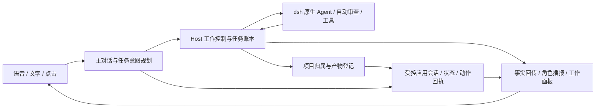

# DeskAI Host 架构与本轮汇报（临时，2026-11-10）

本页记录 2026-11-10 至 11 的历史实现与验证。当前运行入口和 C、D、E 结果见[独立 Host、执行恢复与交付](./host-work-20261112.md)。

本轮目标：参考 Amadeus 的 Host 边界落地对话委派、工作控制、持久状态和应用协作；执行器先接 dsh。状态以文末验证为准，不把设计标为已实现。

## 实施前边界

- 主角色只得到结构化的工作控制和应用动作能力；实际文件、命令和 MCP 工具由 dsh 执行。任务识别由模型完成，不用关键词规则代替 AI 委派。
- Host 管理项目、草稿、任务、执行尝试和 dsh 会话对应关系；写入状态后才对外报告。继续、重试和取消具有独立语义，断线不当作完成。
- 自动审查调用 dsh 原生机制，作用于应用委派的会话；不改用户全局权限、不把自动审查等同无条件批准。
- 打断语音只影响当前对话/播放，不终止后台任务；终止任务必须通过明确任务控制。任务事件与主对话共享界面，但不混用取消标识。
- 产物必须存在且属于对应项目/任务，应用连接只允许登记的入口；模型不能凭一句“做好了”创建虚假的执行事实。
- 应用协作遵循注册清单、状态修订、声明动作和真实回执的边界；仅支持的协议范围会明确说明，断开后动作失败可见。
- 代码保持独立模块，Electron 主进程负责组装和可信 IPC。语音、TTS v2、可配置唤醒和 AEC 继续沿用现有实现。

## 实际修改

1. **AI 委派**：文字与识别后的语音先由独立规划器判断对话、提交、追加、继续、重试、取消、查询和应用动作。Host 校验真实目标再执行，角色拿执行回执回答。工作代理是 dsh，不再只是打开网页让用户手工分派。
2. **工作控制层**：新增 `work-core`，保存项目、草稿、任务、每次执行、会话 ID 和事件。桌面可直接管理任务，也可打开对应的 dsh 原生会话接管。继续复用会话，重试新建会话；重启时未确认的执行标为中断，不自动重跑。
3. **dsh 执行适配**：后台启动原生 Host，以认证 RPC 提交并跟踪任务。任务会话默认启用官方 auto-review，工具执行、MCP/Skills 与审查继续交给 dsh；需要人工回答时显示原生请求。关闭工作窗口不终止任务，停止聊天也不会取消后台工作。
4. **产物与应用协作**：按本次执行清单登记真实文件，检查项目范围和内容摘要。普通产物可预览；单文件 HTML 可在隔离窗口交互。短期一次性票据连接应用，声明状态、事件和动作；角色通过 Host 调用已声明动作，以实际回执更新状态。断开连接后不再执行动作。
5. **统一入口**：工作与应用面板接入现有桌面；本机 API 使用独立认证凭据连接同一 Host。语音、TTS v2、显存驻留、唤醒设置和 AEC 档位沿用现有链路。本轮只迭代源码。

## 源码依据与取舍

参考固定提交 `f86c72a366bd8ef99102c4a5ab2bb7a57fc5522e` 的真实源码，按本项目 TypeScript / Electron / dsh 栈实现相同的职责分离；本轮没有整段搬入其 Python 后端：

- [work_ledger_coordinator.py](https://github.com/Code-Amadeus/Amadeus/blob/f86c72a366bd8ef99102c4a5ab2bb7a57fc5522e/server/work_ledger_coordinator.py)：持久任务、执行尝试与 Provider 事件归属。
- [work_planner.py](https://github.com/Code-Amadeus/Amadeus/blob/f86c72a366bd8ef99102c4a5ab2bb7a57fc5522e/server/work_planner.py)：工作规划与主对话分工，区分修改应用代码和调用现有应用功能。
- [work_artifact_registry.py](https://github.com/Code-Amadeus/Amadeus/blob/f86c72a366bd8ef99102c4a5ab2bb7a57fc5522e/server/work_artifact_registry.py)：产物范围与归属。本项目使用执行专属清单，不扫描整个目录按修改时间猜产物。
- [auip_app_connection.py](https://github.com/Code-Amadeus/Amadeus/blob/f86c72a366bd8ef99102c4a5ab2bb7a57fc5522e/server/auip_app_connection.py) 与 [协议说明](https://github.com/Code-Amadeus/Amadeus/blob/f86c72a366bd8ef99102c4a5ab2bb7a57fc5522e/docs/auip_application_sessions.md)：应用连接、票据、声明动作及回执边界。

本项目应用协议是 **AUIP 思路的精简实现，不能直接接 Amadeus AUIP v0 应用**。执行器仅 dsh；没有引入其 Browser、Codex、Pi，也没有实现多执行器调度。记忆系统、壁纸运行时和 VN Player 不属于这次已实现内容。

## 验证

- 真实模型端到端：规划器委派 dsh，在临时项目从头生成待办应用（没有直接复制示例），登记并校验文件，隔离窗口连接，模型把自然语言转换为应用动作，收到接受回执且状态包含新增待办，关闭后动作被拒绝。2026-11-10 报告：`outputs/host-validation/host-e2e.json`，`passed: true`。
- 复现命令：`node scripts/desktop/host-e2e.mjs --real-model`。需要本机已有模型凭据，会调用真实模型；探针只在临时项目操作。
- `npm run desktop:test`：121 项通过，包含任务持久化、请求接管、取消竞态、应用回执和本机 API 认证。最终 `npm run desktop:build`：通过。
- `npm run m2:smoke`：真实 Electron 界面加载、Host 工作/应用面板、对话重试与打断检查通过，模型为模拟实现。首次包装脚本仍引用旧协议字段和请求数，修正后复跑通过；记录见 `outputs/host-validation/final-checks.json`。
- 探针限制：首次从头生成超过原来的 3 分钟等待，改为 6 分钟；随后一次被会话中断，没有完整报告。最后一次功能断言全部通过，但 Electron 尚未退出时删除其用户目录触发 `EBUSY`，命令退出码为 1。已将清理移到父进程等待 Electron 退出之后，单独运行真实 Electron 生命周期探针验证清理通过；没有为这个清理修改重复调用模型。功能通过与脚本清理失败在这里分别记录。
- 上述验证不涉及真人麦克风、外放双讲、日语唤醒或音质，不能代替实机体验。

## 验收入口与仍待优化

1. 运行 `npm run desktop:dev`。在“工作任务”选择项目；在对话里明确要求创建文件或应用，观察后台任务状态，再用对话追加、查询或取消。也可直接通过任务草稿提交。
2. 任务结束后在“产物与应用”预览；HTML 点击协作入口，连接后用对话调用应用的已声明功能。普通 HTML 不自动具备协作能力，生成时需描述为协作应用或勾选对应选项。
3. 本机 API 描述保存在 Electron 用户数据目录的 `host/local-api.json`；支持认证 `GET /snapshot`、`POST /command`，后者 `type` 为 `work`、`chat` 或 `app-action`。凭据不进入模型上下文。API 随桌面 Host 运行，尚无独立无界面启动命令。
4. `completed` 表示 dsh 本次执行正常结束，文件校验只证明产物存在、归属和内容未变，不等同人工确认任务质量。暂未做 Amadeus 的独立目标完成评估、Git 差异交付、控制器租约和应用跨重启恢复。
5. 当前每轮输入先调用规划模型，再进入角色回复，会增加一次模型判断的延迟；后续可根据实机体验优化。尚需你验收自然语音委派、任务播报是否打扰、原生提问接管体验。本轮无必须先答复才能运行的阻塞项。历史 AEC 误抑制问题仍保留在专项文档，不因本轮架构变化而视为解决。
6. 按最新要求不保留旧数据或旧设计兼容层；旧 Work 的说明已移入历史入口，界面去掉原生 JSON 手填应答，直接使用当前工具结构或打开原生会话。

## 启动窗口未显示修复（2026-11-10）

- 用户反馈执行 `npm run desktop:dev` 后像卡死。复现确认构建和页面加载均已完成，但主窗口 `isVisible()` 为 false；同进程调用 `show()` 后立即正常显示。
- 原因：启动器对 Electron GUI 也传入 `windowsHide: true`，Windows 将主窗口隐藏。仅切换该参数为 false，正常启动即得到可见窗口。
- 修改：只有自动化 smoke 使用隐藏启动，普通开发启动显示窗口。没有新增兼容或回退分支。
- 验证：重新执行原始 `npm run desktop:dev`，构建通过；Windows 显示“DeskAI 语音对话”窗口且 `Responding: true`，本机 Host `/snapshot` 返回 200。未重复运行与本次启动参数无关的全量测试。

## 语音中途只剩文字排查（2026-11-10）

- 从用户实际运行的事件记录确认：前三轮都有 TTS 和音频入队；插话后出现约每 32 ms 一次的暂停、清空，播放编号升到 84，随后升到 110。第四、五轮对话编号为 5、7，有文字但没有启动 TTS。TTS 服务仍为 ready。
- 根因：桌面主进程与对话控制器各自递增播放编号；清空之后暂停状态还被当作正在输出，持续语音帧反复触发打断。新回复因编号落后被 SpeechOutput 当成过期数据丢弃。
- 现场元数据保存在 `outputs/voice-interruption/live-evidence.json`，不包含用户原文和音频。识别同音错字与本次永久失声分开处理，不据此声称 AEC 或 ASR 准确率已修复。
- 修改：移除桌面主进程独立递增的播放编号，由 DialogueController 统一分配；播放回执只接受当前编号。一次连续发声只确认一次打断，清空后立即释放暂停/忙碌状态。停止回复、声音切换和语音恢复共用对话取消入口。
- 新增跨输入控制、对话和语音输出的回归：旧实现重复触发打断；修复后持续 45 个语音帧仅触发一次，后续回复以新编号进入 TTS。模拟验证不替代用户实机继续交流与插话验收。
- 验证：全量 122 项通过；收尾后定向 14 项与主进程类型检查通过；最终原命令启动重新构建成功，已重启修复后的桌面。结果见 `outputs/voice-interruption/verification.json`。请继续多轮交流，并插话后检查下一轮是否仍有声音。

## 角色误称只能对话修复（2026-11-11）

- 原因：工作规划器知道如何委派 dsh，但普通聊天给角色的 Host 上下文只有 `kind: chat`。角色没有收到工作能力说明，又被要求不能假装调用工具，因而可能否认整套应用的执行能力。
- 修改：每轮都传入 Host 能力和本轮回执；能力包含工作代理、可执行的任务控制、当前项目，以及已连接应用声明的动作。角色不能因为自身没有直接挂工具就声称只能聊天，也不能把“具备能力”说成“已经执行”。
- 规划器按语义区分纯能力咨询和具体请求；“能帮我创建某个文件吗”这样的实际请求可以委派，不增加关键词触发规则。
- 真实模型验证：两条能力询问均返回可委派任务，任务数保持为零；随后请求创建临时文件，dsh 任务完成，读回内容正确。命令 `node scripts/desktop/host-e2e.mjs --real-model --capabilities` 退出码 0，报告 `outputs/host-validation/capabilities-e2e.json`。这是有限场景验证，不代表所有自然语言表达都已覆盖。
- 回归：123 项测试通过，M2 界面冒烟检查与构建通过；已启动修复后的桌面供验收。检查摘要：`outputs/host-validation/capabilities-checks.json`。
