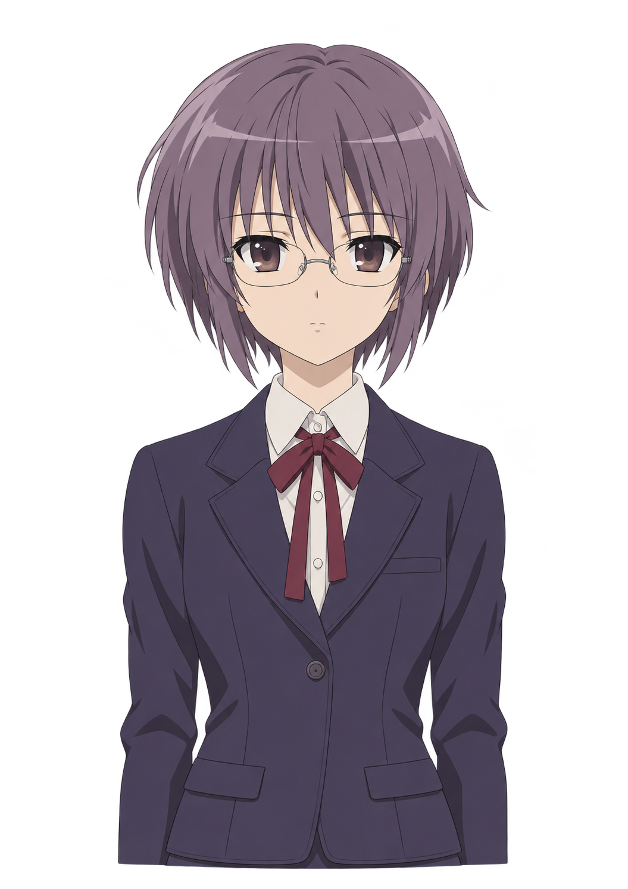

# 长门 Live2D 素材与调校

这张 1055 × 1491 的透明立绘用于确定脸部、服装和半身取景，预留了发顶与肩膀的分层空间。长门的 Live2D 模型待拆层和绑定。桌宠启动默认使用现有的长门造型，官方 Mao 和 Haru 样例可在「角色」页选用。[立绘原文件](./art/nagato-live2d-reference.png) · [官方样例](https://www.live2d.com/en/learn/sample/)

## 可协助的事项

- 如果已有可用的长门模型，提供 `.model3.json` 所在目录。保留同目录结构中的 `.moc3`、贴图、物理、姿势、表情和动作。当前运行时使用 Cubism Core 5.2，导出时选择可在该版本加载的模型格式。
- 如果从立绘开始制作，优先拆分前后发、鬓发、脸、眼白与虹膜、上下眼睑、眉、嘴内外层、眼镜、领带和肩部。补齐转头时露出的区域。第一轮绑定可先覆盖头身转动、眨眼、视线、呼吸、嘴部开合与发丝物理。
- 导入后在「角色」选择模型。先用「待机」「倾听」「思考」确认眼神与头部幅度，再用「播报」调开合、展唇与圆唇。用「取景与动态」对齐半身和全身，确认后点「应用到角色」。
- 拿到目标模型后，用实际麦克风和扬声器连续插话三次，观察字幕与嘴型是否及时收起和恢复。再在不同缩放比例的屏幕之间拖动，确认人物边缘的点击穿透、手动摆位和重新显示。

## 可提供的反馈

遇到表情切换太重、脸偏离画面中心、眼镜抖动或嘴型过大时，记下模型名、状态、当前幅度和一张截图。需要调整原始绑定时，再附上涉及的参数 ID。应用内的外观调校保存到角色所选的模型配置。
