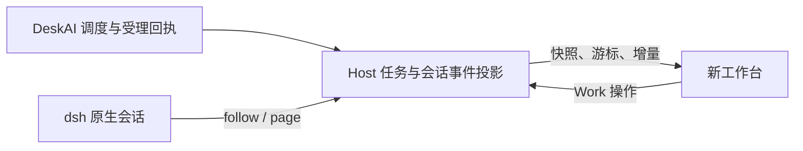

# Live2D 角色与实时 Work 工作台

2026-11-12 设计。Live2D 和实时 Work 工作台已接入，联合软件验证通过。长门目标模型及物理设备验收待完成。壁纸搁置。[验证记录](./verification.md)

## I. Live2D 角色

桌宠默认显示现有的长门造型。角色页可选用 Mao、Haru 或导入模型，预览和调校后应用到角色。透明桌宠与独立预览共用 Live2D 渲染器。参考 Amadeus 的模型资源检查、加载代次与嘴型驱动，将状态和 PCM 信号接到 DeskAI2 的现有桌宠与输出链路。[实际架构](./architecture.md#live2d-呈现) · [长门素材与调校](./live2d-tuning.md)

### 模型和渲染选型

- **Cubism SDK for Web** 作为 Electron 内的首选渲染路线。先用一套带物理、表情和口型的官方样例验证实际 WebGL 渲染。用同一模型对照官方 Web Samples 与 Pixi 适配器在透明窗口、遮罩、上下文恢复和资源释放上的表现，再固定运行时版本。[官方 Web Samples](https://github.com/Live2D/CubismWebSamples) · [Cubism Core](https://docs.live2d.com/en/cubism-sdk-manual/cubism-core/)
- **Amadeus** 的实验后端已实现本地 `.model3.json` 导入、独立预览、模型表情与口型参数检查，以及载入代次控制。复用这些交互与资源管理思路。其已验证的窗口和模型范围以原记录为准，DeskAI2 的透明桌宠单独验收。[固定提交的 Live2D 设计](https://github.com/Code-Amadeus/Amadeus/blob/be9b97aef2ac3affb200998f8af3aab72aa22f6c/docs/live2d_character_visuals.md) · [渲染源码](https://github.com/Code-Amadeus/Amadeus/blob/be9b97aef2ac3affb200998f8af3aab72aa22f6c/render/web/live2d_character.js) · [上游许可](https://github.com/Code-Amadeus/Amadeus/blob/be9b97aef2ac3affb200998f8af3aab72aa22f6c/LICENSE)
- **Open-LLM-VTuber 与 AIRI** 分别参考透明桌宠中的模型和表情配置、自动眨眼与视线运动。可直接采用符合使用范围的模型或组件，采用前记录源版本和许可。[Open-LLM-VTuber Live2D 指南](https://docs.llmvtuber.com/docs/user-guide/live2d/) · [AIRI 角色动画](https://github.com/moeru-ai/airi#readme)

最终模型优先长门方向，接入已有授权模型或单独准备模型。按眨眼、眼球、头部和身体角度、口型、发丝或衣物物理、表情和待机动作评审模型质量。项目的角色卡、音色和 Live2D 资源各有 ID，角色可配置默认外观。导入时校验 `.model3.json` 引用的模型、贴图和动作文件，记录参数映射及资源来源。SDK、模型和素材分别核对本地使用与随项目发布的范围。[官方样例模型](https://www.live2d.com/en/learn/sample/) · [SDK 发布许可](https://www.live2d.com/en/sdk/license/)

### 动效与播放同步

- 透明桌宠窗口管理位置、缩放、拖动与点击穿透。模型渲染器管理加载、表情、动作和销毁。外观页提供模型预览、参数检查与表情映射，换模型以独立加载代次确认就绪。窗口隐藏时暂停绘制，可见时从当前状态恢复。[现有桌宠窗口](../../apps/desktop/src/pet-window.ts) · [现有状态投影](../../packages/desktop-pet/src/projection.ts)
- 待机有呼吸、随机眨眼与轻微视线游移。监听时通过视线和姿态回应，生成与等待时使用克制的过渡，播报时加入嘴型和自然表情。动作和表情由模型清单映射，支持减少动态效果。口型先接幅度和平滑包络，再用具备相应参数的模型验证口形变化。
- 用播放器实际输出的 PCM 计算嘴部开合。按音频时钟带上会话、播放代次和句子身份，跨窗口只传送归一化口型值和必要状态。字幕从实际开始播放的句子推进。清除、暂停、断线或切换会话时收口并清除过期字幕，下一代播放重新驱动模型。[现有 PCM 播放器](../../apps/desktop/renderer/src/player.ts) · [Cubism 口型文档](https://docs.live2d.com/en/cubism-sdk-manual/lipsync/)

### 实施与验收

1. **I1 样例验证与资源选型。** 在真实 Windows Electron 窗口跑通样例的模型、表情、物理和口型，确认 Core 与模型版本、授权和目标模型的参数表。目标角色素材待准备时可继续打磨运行时。
2. **I2 模型运行时与播报驱动。** 完成预览、动作映射、透明桌宠和真实 PCM 嘴型。用静音与音频片段检查开合跟随，覆盖连续插话、暂停和重新播报。
3. **I3 角色效果与设备验收。** 用目标模型试待机、监听、播报和表情切换，检查多屏 DPI、缩放、拖动、隐藏恢复及反复切换模型。与 Qwen、v2 TTS 同时运行时记录帧间隔、显存、首段音频延迟和卡顿，再确认资源预算。

## J. 实时 Work 工作台

### 选型

首选自建 Electron 工作台，用 DeskAI Host 串起角色对话、跨项目任务、dsh 轨迹、Diff 和验收。保留原生 dsh 会话作为深入检查与权限处理入口。另一条可评估的路线是在 dsh Web UI 的 Cordis 扩展点增加面板，验证能否用正式接口接入 DeskAI 的会话和任务状态。两条路线都从新布局出发，数据与操作使用 Host 接口。[dsh 扩展架构](https://deepseek-harness.github.io/deepseek-harness/en/reference/) · [现有原生会话入口](../../apps/desktop/src/work-window.ts)

- 本机锁定的 dsh `0.2.1-rc.2` 的 Web 组合已声明 **Trajectory**、子代理视图、`sessionStats` 和 `turnOutline`。Trajectory 提供流式跟随、按轮次浏览和事件检查器。统计和轮次投影分别提供原生会话耗时、计数和历史定位，可按实际范围用于工作台。[Trajectory](https://github.com/deepseek-ai/deepseek-harness/blob/687f282e8625c6b8d11ff58211a90524be2e4317/packages/client/ui-trajectory/README.md) · [会话统计](https://github.com/deepseek-ai/deepseek-harness/blob/687f282e8625c6b8d11ff58211a90524be2e4317/packages/session/session-stats/README.md) · [轮次大纲](https://github.com/deepseek-ai/deepseek-harness/blob/687f282e8625c6b8d11ff58211a90524be2e4317/packages/session/session-turn-outline/README.md)
- **Better Sidebar** 参考按会话组织侧栏、工具区和可扩展面板。**dsh 实验性 Agent Team** 和社区 **dsh-agent-teams** 参考具名成员、真实消息和共享任务状态。只有实际执行启用了相应能力，并确认会话与消息归属后才接入成员交流。现有调度器与 dsh 执行器之间的追踪可以先做。社区插件与锁定版本的兼容性待验证。[Better Sidebar](https://github.com/omdsh-dev/DSH-better-sidebar) · [dsh 实验性 Team](https://github.com/deepseek-ai/deepseek-harness/blob/687f282e8625c6b8d11ff58211a90524be2e4317/packages/experimental/agent-team/README.md) · [社区 dsh-agent-teams](https://github.com/nanmicoder/dsh-agent-teams)

### 事件和指标

Host 提供独立的逐任务轨迹订阅。Provider 适配器按原生请求和轮次恢复执行，工作台从受理回执和 dsh 原生事件投影双方交流、逐请求用量和工具时间线。[Host API](../../apps/host/src/api.ts) · [原生会话恢复](../../packages/dsh-adapter/src/session-feed.ts) · [Work 轨迹](../../apps/host/src/work-trace.ts)

- **双方交流**展示用户委派、调度意图与所选目标、Host 受理回执、发往执行器的任务、执行器回复与提问、用户或调度器的补充，以及结果回传。调度记录在 Host 受理后归入任务。时间线标出参与方和时间。若后续接入 Agent Teams，需以实际原生成员与会话 ID 归属成员交流。
- **执行状态**根据 Host 的 Work 与 Attempt 状态，以及 dsh 的轮次、步骤、工具、权限与提问事件推进。工具调用可展开对应结果和耗时。提供方终态、产物核验与用户验收各显示实际结果。只有执行器提供总量时才显示百分比。
- **思考深度**按调度与执行的每次模型请求显示模型和记录中的 `thinking`、`reasoningEffort`。面板区分请求档位与提供方明确回报的值。有记录时显示推理 token、首 token 时间、生成与工具耗时。过程详情使用公开计划、可见回复和提供方明确输出的摘要。
- **缓存命中**从模型调用的用量读取。锁定版 dsh 将用量写入 `assistant/message.usage`，`TokenUsage` 中未缓存输入、`cacheReadTokens` 与 `cacheWriteTokens` 是互斥计数。分母按有完整口径的输入 token 合计计算，命中率为缓存读取量除以该合计。使用 DeepSeek Chat Completions 原始用量时，以 `prompt_cache_hit_tokens / prompt_tokens` 计算。工作台显示单次、累计和已上报请求数，区分明确的零与未上报。原生流暂未送出用量时显示等待，最终记录更新同一调用的指标。[DeepSeek 用量字段](https://api-docs.deepseek.com/api/create-chat-completion/)

### Host 接口与前端结构

Host 用 `conversationId`、`operationId`、Task、Attempt、原生会话与请求 ID 串起链路。适配器把原生事件转换成带来源序号的可展示记录。按任务订阅快照和有序增量，断线按游标补页，重放按原生身份去重。同一原生会话可能跨多个 Attempt，执行指标只累计本次绑定的请求。原生全会话统计在会话范围显示。调度受理和任务状态由 Work 账本持久化，高频文本与计时由会话日志和有界投影提供。用户动作复用 Host 现行受理入口。[调度协调](../../apps/desktop/src/turn-coordinator.ts) · [Work 操作与回执](../../packages/work-core/src/operations.ts)

工作台设对话、工作、角色三个入口。工作视图左侧列项目和活跃任务，中间显示所选 Attempt 的交流与执行时间线，右侧查看模型指标、待处理请求、产物和 Diff。窄窗把详情收进抽屉。新事件可跟随，向上翻阅时保持位置。整体采用浅深主题共用的中性底色、清楚的状态色与紧凑排版。普通正文和技术标识使用不同字重或字体，状态同时有文字标记，键盘可到达主要操作。

### 实施与验收

1. **J1 取真实事件样本。** 用当前 dsh 路由跑一项临时任务，覆盖调度、工具、问题或授权、结束与续跑。核对实际请求档位、用量、缓存、会话 ID 和字段缺失情况。若需展示团队消息，再用隔离配置验证一种 Team 插件。
2. **J2 接通事件与指标。** 实现逐任务订阅和重连补页。用同一 Attempt 的调度与执行样本确认双方消息、工具结果、请求指标正确归属。重复与乱序事件以来源 ID 校准，用量只累计一次。
3. **J3 重做桌面面板。** 用真实数据构建任务导航、实时轨迹和详情。支持取消、补充、回答、查看原生会话、Diff 与验收。用并行任务检查选择和滚动保持稳定，再以新工作台替换旧面板。
4. **J4 联合验收。** 两条真实任务并行，其中一条暂停等待输入后继续，另一条完成并核验产物。重开面板、断线重连后，时间线可追溯且统计一致。核对缺失用量提示、授权入口和长时间线滚动。最后在 Live2D、播报和活跃任务同时运行时做基础冒烟和实机检查。

J1 至 J3 的实现、J4 的真实任务及桌面验证见[工作台验证](./verification.md#j-实时-work-工作台)。Live2D、播报与活跃 Work 的联合软件验证见 [I3 记录](./verification.md#i-live2d-角色)。
