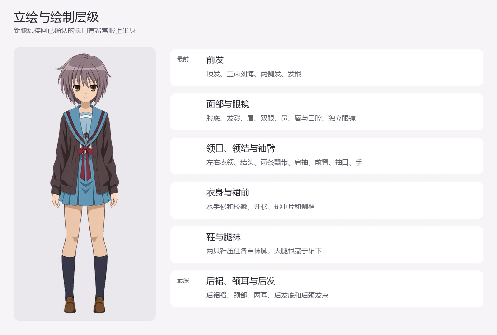
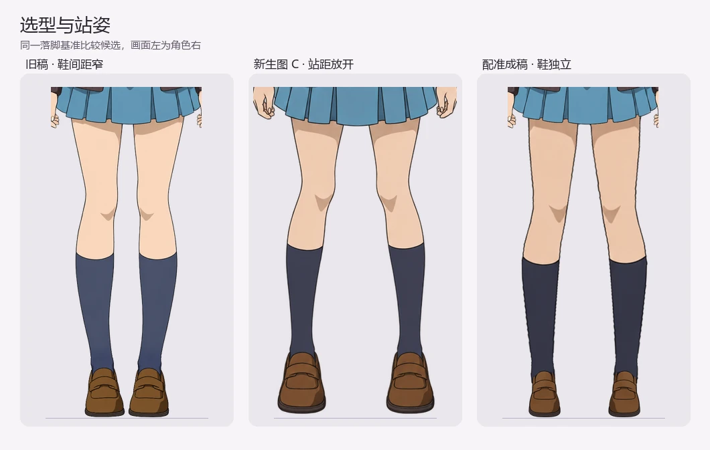
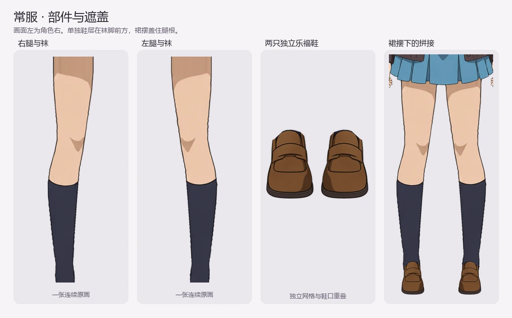
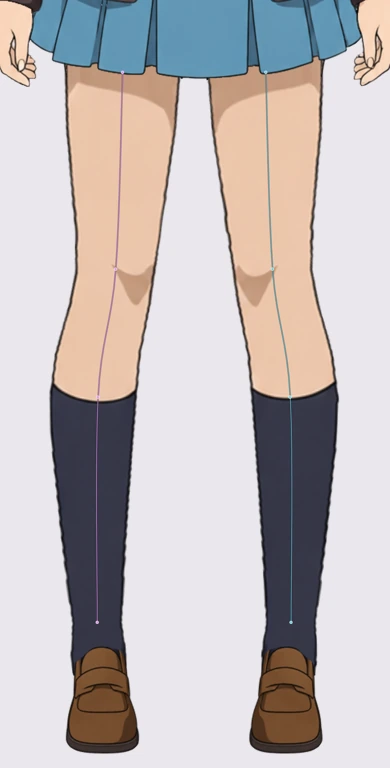
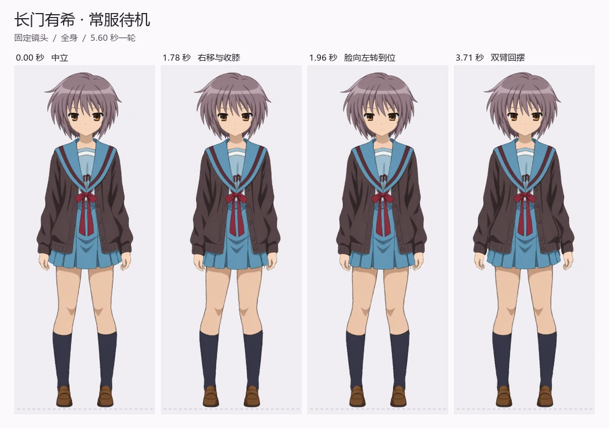
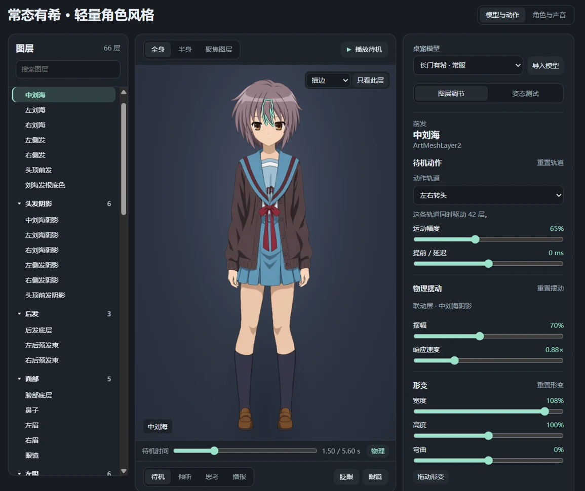

# 长门有希常服 Live2D 制作记录

这一轮重做常服的中立站姿与腿鞋分层。选型以已确认的常服上半身、二次元动画风格和棕色乐福鞋为基础。待机继续使用肩肘错峰、头部随重心移动和衣发物理。

## 1. 研究真央的分层和站姿

打开官方 CMO3 的原画与 ArtMesh，并用 PRO 和 SDK 的中立画面核对。真央的 `PartLeg` 每侧是短裤、整条腿与袜、鞋。大腿、膝盖、小腿与袜连续绘制，每条腿用 57 个顶点、81 个三角形。鞋单独在袜前。腿各有四点 Deform Path 帮助编辑关键形，腿与鞋各用自己的身体 X/Y Warp，共享下身 Z。主待机的鞋底接触带近乎固定。 [虹色真央官方工程](https://www.live2d.com/en/learn/sample/niziiro-mao/) · [Cubism Deform Path](https://docs.live2d.com/en/cubism-editor-manual/deformpath/)

真央的中立是轻俯视正面，两只鞋底等高，膝中心距小于脚踝中心距。以短裤下缘至鞋底为 `H`，鞋底支点中心距为 `26.8% H`，鞋尖附近最窄空隙为 `17.2% H`。采用这一测量口径配准长门。

## 2. 生图与配准

用 GPT ImageGen 重抽站姿。前两稿的脚距接近旧稿，选第三个全身构图作为腿部底稿。另生成一张连袜脚的生产图和一张独立乐福鞋素材。配准时以真央的腿线和落脚距离定轮廓，将袜脚补至鞋口下方，鞋沿开口弧线分离，左右鞋使用同一原画镜像。长门的头脸、衣服和双手继续使用上一轮通过审阅的图层。

注册画布为 `747 × 2106`。成稿以裙边到鞋底 `839 px` 为基准，鞋底等高，支点中心距 `226 px`（`26.9%`），两鞋最窄空隙 `137 px`（`16.3%`）。膝中心距 `195 px`，踝中心距约 `242 px`。袜脚和鞋的透明度重叠约 `36 px`。

## 3. 分层与遮盖

重开 PSD 检查了 `66` 层的命名、坐标和中立合成。源 PSD 的后发 3 层、颈耳 3 层、制服与四肢 23 层、面部 30 层、前发 7 层。实际遮盖关系见上方全身图。虹膜、高光留在各自的眼白遮罩内。发影落在脸部，眼镜独立。两侧袖臂分别有上臂袖、前臂袖、袖口和手，按肩肘链跟随。

腿部的两张原画各自从裙下补绘到完整袜脚。裙前片压腿根，鞋面盖住袜脚，后裙在后。每侧的腿袜与鞋是两个独立 ArtMesh。屏幕左侧对应角色右侧。

## 4. 绑定与运行

上身沿用现有头脸、肩肘、呼吸和衣发控制。下身共用身体 Z，四个同级 5×5 Warp 分别绑定左右腿袜和左右鞋。每条腿保留四点 Deform Path，膝部关键形连续沿网格传递，鞋口随动衰减至鞋底。待机继续使用 5.60 秒的曲线。在 PSD2Live 与 CMO3 回读核对 66 个 ArtMesh、43 个参数、21 条待机轨道和两条变形路径。

DeskAI 用模型目录的同名 `.layers.json` 声明可调的待机、物理和形变。同一图层的运动、物理和形变在「图层调节」显示。标准 Cubism 模型可直接查看与点选原有网格，选中部件后按模型参数范围做姿态测试。Cdi3 提供部件和参数的名称。[项目中的层与动作配置](../../apps/desktop/models/live2d/nagato-uniform-review/nagato-uniform-review.layers.json)

## 5. 验收

- 实测待机与 1.6 倍幅度，裙边和鞋口保持盖合，双鞋底在默认循环的最大网格位移约 `0.03 px`。1.78 秒画面右膝内收约 `6.0 px`，左膝约 `4.9 px`。旧比例轴的两端也检查了裙腿遮盖。
- 在 Windows Electron 测试长门与虹色真央的图层浏览、点选和网格显示。长门通过待机定位、姿态、眨眼、眼镜和图层设置保存。本地模型的同名侧车导入与重启恢复有单独回归。

## 交付

- 分层 PSD 用于绘画与重新绑定。可编辑 PSD2Live 工程保存完整绑定，CMO3 与 CAN3 用于 Cubism，DeskAI 加载对应的 MOC3 和贴图。[分层 PSD](../../apps/desktop/models/live2d/nagato-uniform-review/nagato-uniform-review.psd) · [PSD2Live 工程](../../apps/desktop/models/live2d/nagato-uniform-review/nagato-uniform-review.psd2live) · [CMO3 工程](../../apps/desktop/models/live2d/nagato-uniform-review/nagato-uniform-review.cmo3) · [CAN3 动作](../../apps/desktop/models/live2d/nagato-uniform-review/nagato-uniform-review.can3)
- 下次迭代从同镜头的 0、1.78、1.96 和 3.71 秒开始复核腿脚、领肩与袖口。[制作 skill](../../.agents/skills/producing-live2d-characters/SKILL.md) · [站姿待机调校指南](./live2d-standing-idle-guide.md)
